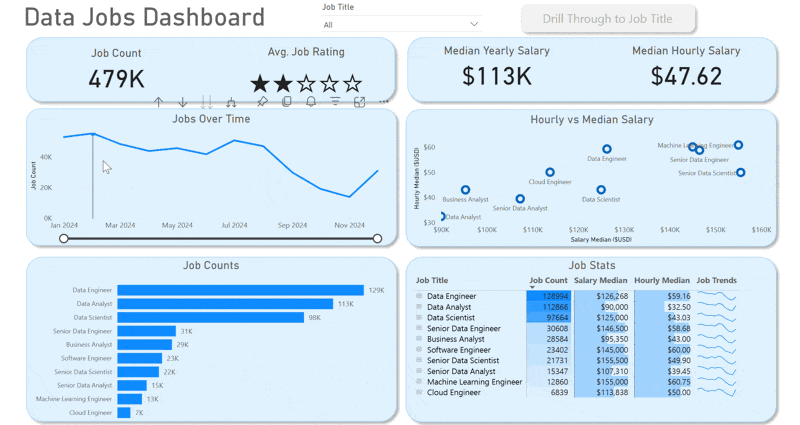
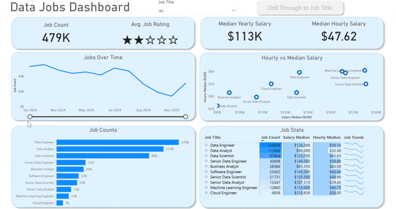
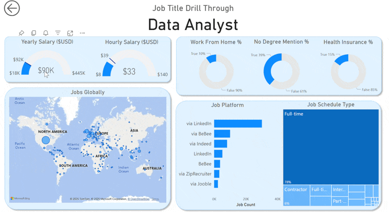

# Data Jobs Dashboard

An interactive Power BI dashboard for exploring the data jobs market. It is designed for job seekers, people considering a career transition, and professionals comparing opportunities across data roles.

## Target audience

- Job seekers
- Job transitioners
- Professionals looking to switch roles

## Problem statement

People looking for data roles often have to gather information from scattered job postings and job boards. This makes it difficult to quickly understand job-market trends, compare typical compensation, and assess factors that affect job quality.

This dashboard brings job volume, salaries, locations, work arrangements, benefits, and job platforms together in one interactive report.

## Dashboard preview

The report includes an overview page and a job-title drill-through page. Use the Job Title filter to focus the report on a role, or select a role and use the drill-through button to open its detailed view.



### Page 1: Data jobs overview

The overview page summarizes job volume, average job rating, median annual and hourly salary, job trends over time, salary comparisons by role, and job counts. A job statistics table lets you compare these measures across job titles.



### Page 2: Job-title drill-through

The drill-through page provides details for a selected job title, including salary indicators, remote work, degree mentions, health insurance, global posting locations, job platforms, and schedule types.



## What the dashboard helps explore

- Which data job titles have more postings
- How median annual and hourly salaries compare across roles
- How job posting volume changes over time
- How salary patterns vary by job title
- Where jobs are posted and which platforms list them
- How roles differ in remote work, degree mentions, health insurance, and schedule type

## Tools and Power BI features

- Power BI Desktop
- Interactive filters and visual interactions
- Drill-through from the overview to a job-title detail page
- Bar, line, scatter, table, gauge, donut, map, and treemap visuals

## Open the report

1. Open the `.pbix` report file in Power BI Desktop.
2. Use the Job Title filter to choose a role.
3. Explore the overview visuals, then use the drill-through button or context menu to view details for a selected job title.
4. Use the back button on the detail page to return to the overview.

## Project files

Keep the `images` folder beside this `README.md` file. The dashboard previews use the supplied GIF filenames as they are:

```text
images/
├── Project1_Dashboard_Overview.gif
├── Project1_Dashboard_Page1.gif
└── Project1_Dashboard_Page2.gif